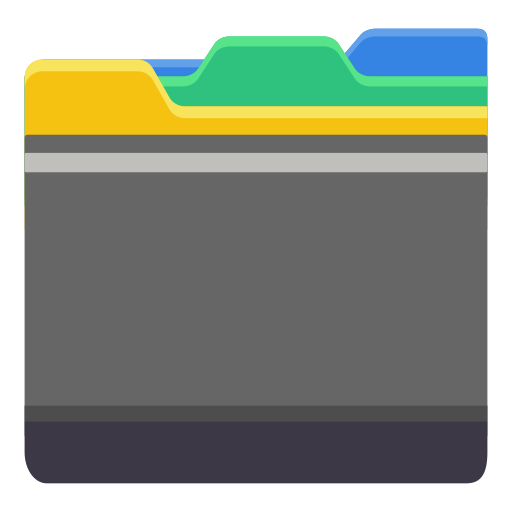

#  Arkha

A fast graphical file manager for Linux, modelled on Caja (MATE). It uses your desktop's GTK theme, icons and bookmarks, and feels at home on MATE, but works on any desktop.

<!-- Screenshots go here. -->

## Highlights

- **Familiar:** menus, toolbar, path bar, side pane and tabs as in Caja, and notes, emblems, custom icons and bookmarks shared with it.
- **Four views:** icons, list, compact and columns, with the list's columns and sort order your choice.
- **Split view:** two panes side by side, each with its own tabs, swapped with Ctrl+U.
- **Tabs like a browser:** reopen closed tabs, drag them between windows or out into a new one.
- **Info panel:** a folder's cover picture, an image or a file's preview beside the files.
- **Rename many files at once:** change case, insert, remove, search and replace (also with regular expressions), number them.
- **Safe file operations:** undo and redo, and copies checked against their originals when it matters.
- **Checksums** (MD5, SHA-1, SHA-256, CRC32 and more) in a file's properties.
- **Your own context menu entries and thumbnailers,** and every keyboard shortcut changeable.
- **In English and German,** following your system's language or the one you choose.
- **Light and quick:** it opens big folders with less CPU and memory than Caja and Nemo.

The [full list of features](docs/FEATURES.md) has every detail.

## Installing

Packages for each release are on the project's Releases page, and for Arch Linux in the AUR:

- **Debian 13 or newer, Ubuntu 26.04 or newer:** `sudo apt install ./arkha_*.deb`
- **Fedora:** `sudo dnf install ./arkha-*.rpm`
- **Arch Linux:** from the AUR, `arkha` (built from the release's sources), `arkha-bin` (prebuilt) or `arkha-git` (the newest development version).

Arkha uses GVfs for the Trash, network places and drives; most desktops have it already. To build it yourself, see [BUILDING.md](BUILDING.md). If you package Arkha for a distribution, build it from a release's git tag, never from the prebuilt files: see [Packaging Arkha for a distribution](BUILDING.md#packaging-arkha-for-a-distribution).

Your settings are kept in `~/.config/arkha/`.

## Translations

Arkha speaks English and German so far. A new language is one file to translate; [CONTRIBUTING.md](CONTRIBUTING.md#translating) explains how.

## Contributing

Bug reports, translations and code are welcome: see [CONTRIBUTING.md](CONTRIBUTING.md).

## Written by an AI

Arkha's code, its German translation and its documentation were written by an AI, Anthropic's Claude (in Claude Code), not by a human programmer. Its maintainer decided what Arkha should do and how it should behave, and tried out and checked the results.

## License

Arkha is free software under the [GNU General Public License, version 3 or later](LICENSE). Some of its texts and the search's groups of file types come from [Caja](https://github.com/mate-desktop/caja) (GPL-2.0-or-later), by the MATE developers.
