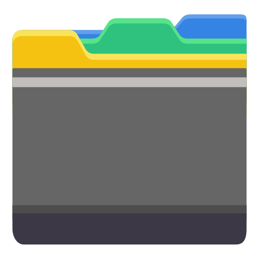
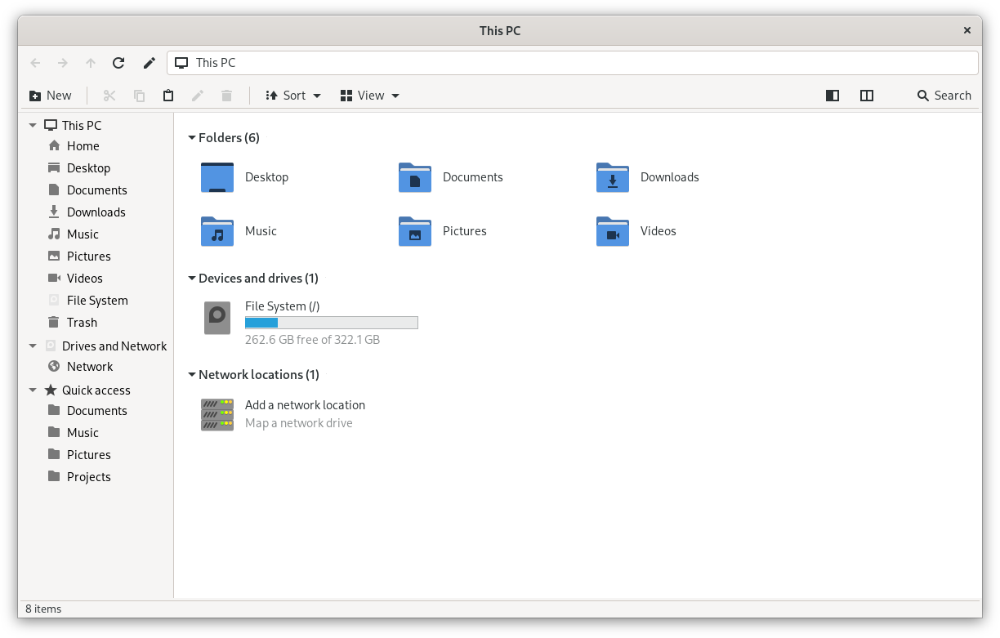
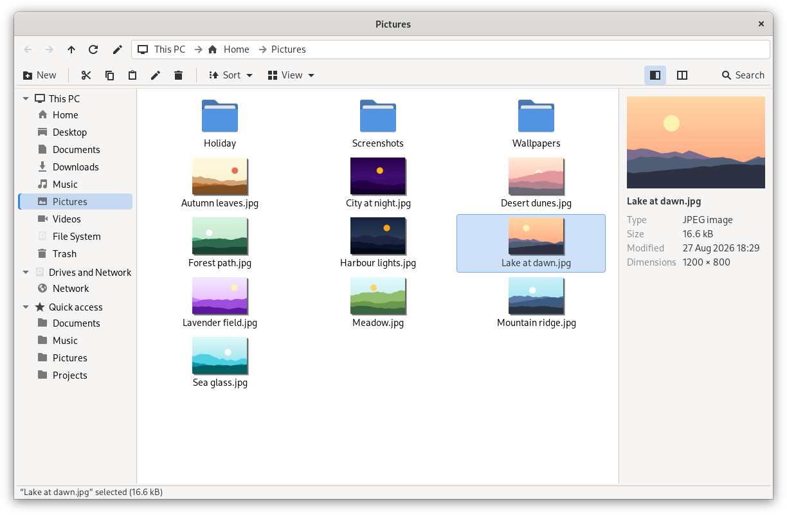
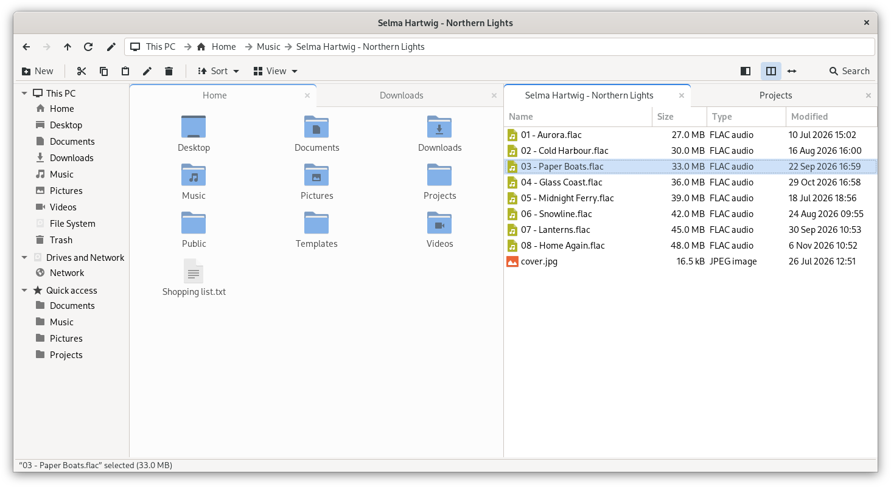
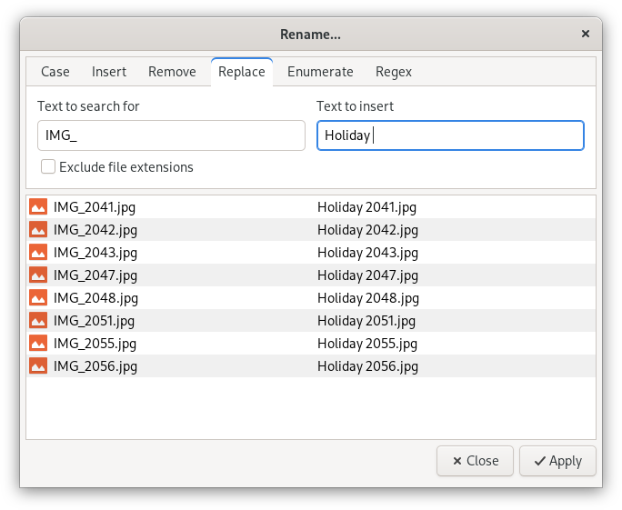
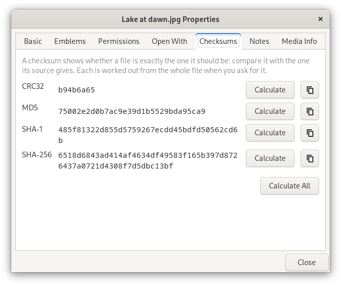

#  Voyager

A fast graphical file manager for Linux, with the look of Windows Explorer and the features of Caja (MATE). It uses your desktop's GTK theme, icons and bookmarks, and feels at home on MATE, but works on any desktop.

<!-- Light or dark, as the reader's GitHub is; made with Adwaita and Papirus. -->
<picture>
  <source media="(prefers-color-scheme: dark)" srcset="docs/screenshots/thispc-dark.png">
  
</picture>

<picture>
  <source media="(prefers-color-scheme: dark)" srcset="docs/screenshots/icons-dark.png">
  
</picture>

<picture>
  <source media="(prefers-color-scheme: dark)" srcset="docs/screenshots/split-dark.png">
  
</picture>

<picture>
  <source media="(prefers-color-scheme: dark)" srcset="docs/screenshots/rename-dark.png">
  
</picture>
<picture>
  <source media="(prefers-color-scheme: dark)" srcset="docs/screenshots/checksums-dark.png">
  
</picture>

## Highlights

- **Familiar:** the look and layout of Windows Explorer (address bar, command bar, navigation pane, This PC with drive bars, network and Windows shares), and notes, emblems, custom icons and bookmarks shared with Caja.
- **Four views:** icons, list, compact and columns, with the list's columns and sort order your choice.
- **Split view:** two panes side by side, each with its own tabs, swapped with Ctrl+U.
- **Tabs like a browser:** reopen closed tabs, drag them between windows or out into a new one.
- **Info panel:** a folder's cover picture, an image or a file's preview beside the files.
- **Rename many files at once:** change case, insert, remove, search and replace (also with regular expressions), number them.
- **Safe file operations:** undo and redo, and copies checked against their originals when it matters.
- **Checksums** (MD5, SHA-1, SHA-256, CRC32 and more) in a file's properties.
- **Your own context menu entries and thumbnailers,** and every keyboard shortcut changeable.
- **In English and German,** following your system's language or the one you choose.
- **Light and quick:** it opens big folders with less CPU and memory than Caja and Nemo.

The [full list of features](docs/FEATURES.md) has every detail.

## Installing

Packages for each release are on the project's Releases page:

- **Debian 13 or newer, Ubuntu 26.04 or newer:** `sudo apt install ./voyager_*.deb`
- **Fedora:** `sudo dnf install ./voyager-*.rpm`
- **Arch Linux:** `sudo pacman -U ./voyager-*.pkg.tar.zst`

Voyager uses GVfs for the Trash, network places and drives; most desktops have it already. Windows shares (SMB) and finding computers in the network need its SMB, WSDD and DNS-SD backends (`gvfs-smb`, `gvfs-wsdd`, `gvfs-dnssd` on Arch; `gvfs-backends` on Debian and Ubuntu). To build it yourself, see [BUILDING.md](BUILDING.md). If you package Voyager for a distribution, build it from a release's git tag, never from the prebuilt files: see [Packaging Voyager for a distribution](BUILDING.md#packaging-voyager-for-a-distribution).

Your settings are kept in `~/.config/voyager/`.

## Translations

Voyager speaks English and German so far. A new language is one file to translate; [CONTRIBUTING.md](CONTRIBUTING.md#translating) explains how.

## Contributing

Bug reports, translations and code are welcome: see [CONTRIBUTING.md](CONTRIBUTING.md).

## Origin

Voyager is a fork of [Arkha](https://github.com/dekart811/arkha) by dekart811, with the look and layout of Windows Explorer, This PC, Windows shares and more. The first version of Voyager is 1.1.0; it keeps Arkha's settings (they are copied from `~/.config/arkha` the first time it starts).

## Written by an AI

Voyager's code, its German translation and its documentation were written by an AI, Anthropic's Claude (in Claude Code), not by a human programmer. Its maintainer decided what Voyager should do and how it should behave, and tried out and checked the results.

## License

Voyager is free software under the [GNU General Public License, version 3 or later](LICENSE), as Arkha is. Copyright 2026 HydrAPI and dekart811 (Arkha). Some of its texts and the search's groups of file types come from [Caja](https://github.com/mate-desktop/caja) (GPL-2.0-or-later), by the MATE developers.
